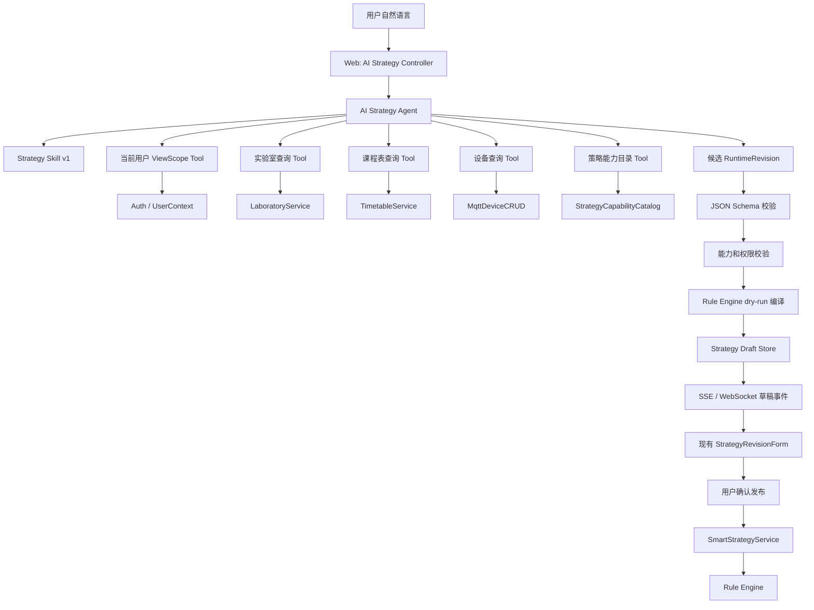

# 智能策略自然语言配置改造计划

> 状态：规划中  
> 目标版本：V1  
> 适用范围：`lab-system-cloud`、`lab-system-frontend`  
> 最后更新：2026-09-06

## 1. 背景

当前系统已经具备实验室、用户权限、设备管理、课程表、智能策略编排、策略版本持久化和规则引擎执行能力。智能策略目前主要由用户通过前端表单手工配置，最终形成 `rule-api` 中的 `RuntimeRevision`，再由规则引擎完成编译、注册和执行。

下一阶段计划增加一个基于 Spring AI 的智能策略 Agent，使用户能够使用自然语言描述实验室自动化需求。例如：

> 工作日 301 实验室有课时提前 15 分钟打开空调，设置为制冷 24℃；课程结束 20 分钟后，如果室内无人则关闭空调和照明。

Agent 不只是进行一次“文本转 JSON”，而是像编码 Agent 一样，在当前用户权限范围内主动查询实验室、课程表、设备及设备能力，通过多轮工具调用补齐事实，生成并校验智能策略草稿，最后驱动前端真实策略表单展示。

## 2. 建设目标

V1 需要实现以下闭环：

1. 用户在智能策略页面输入自然语言需求。
2. Agent 获取当前登录用户身份和实验室可见范围。
3. Agent 按需查询实验室、课程表、设备和设备能力。
4. Agent 依据版本化的 Strategy Skill 生成候选 `RuntimeRevision`。
5. 候选策略经过 JSON Schema、领域目录和规则编译器三层校验。
6. Agent 将合法结果保存为可版本化的策略草稿。
7. 前端收到草稿更新事件，将草稿加载到现有策略表单中。
8. 用户检查 Agent 的摘要、假设和警告，并可继续通过自然语言或表单修改。
9. 只有用户明确确认后，系统才通过现有智能策略服务创建或更新正式 Revision。

该能力的核心原则是：

> Agent 负责理解、检索、提案和修正；确定性服务负责权限、校验、持久化和执行；用户负责最终确认。

## 3. 非目标

V1 暂不包含：

- Agent 直接控制真实设备。
- Agent 自动启用策略。
- Agent 未经确认直接覆盖正式策略。
- 让模型自由生成 React 组件或任意前端布局。
- 使用向量数据库保存业务主数据。
- 复杂知识库 RAG。
- 多 Agent 协作。
- 依赖模型暴露完整思维过程。
- 根据摄像头、门禁记录等尚不存在的能力推断“实验室无人”。

## 4. 已有基础与改造边界

### 4.1 可复用能力

| 能力 | 现有入口 | Agent 用途 |
| --- | --- | --- |
| 用户身份和 ViewScope | `auth-api/UserContext` | 确定用户和可见实验室，禁止模型指定任意用户身份 |
| 实验室查询 | `base-api/LaboratoryService` | 解析“301 实验室”“信息楼实验室”等自然语言实体 |
| 课程表查询 | `edu-api/TimetableService` | 解释“上课前”“课程结束后”“工作日有课时”等条件 |
| 设备查询 | `mqtt-api/MqttDeviceCRUD` | 将“所有空调”“靠窗灯具”解析为真实设备 ID |
| 策略领域契约 | `rule-api/RuntimeRevision` | Agent 最终生成的确定性策略数据结构 |
| 策略编译器 | `rule-engine/RuntimeRevisionCompiler` | 校验条件组引用并执行 dry-run 编译 |
| 策略持久化 | `rule-api/SmartStrategyService` | 用户确认后创建或更新正式策略 |
| 实时消息基础设施 | Redis/WebSocket 通道 | 向前端推送 Agent 和草稿状态 |

### 4.2 模块边界

建议新增两个 Maven 模块：

```text
domains/ai-strategy/api
domains/ai-strategy/service
```

- `ai-strategy/api`：保存 Agent 会话、工具 DTO、草稿、校验结果和事件契约，不依赖具体模型厂商。
- `ai-strategy/service`：Spring AI、模型适配、工具调用循环、Strategy Skill、草稿编排和模型观测。
- `web`：提供前端 REST/SSE 入口，解析当前登录身份并调用 AI Strategy 服务。
- `rule-api`：继续持有稳定的 `RuntimeRevision`，不得依赖 Spring AI。
- `rule-engine`：继续负责确定性编译和执行，不引入 Prompt 或模型调用。

V1 可以继续放在现有多模块仓库中，但 `ai-strategy/service` 应当能够独立启动和部署。模型依赖、调用限额和故障不应影响规则引擎处理设备事件。

## 5. 总体架构



## 6. Agent 工作循环

Agent 使用受限的工具调用循环实现 ReAct 风格的任务处理，但不要求保存或展示模型的完整推理文本。

```text
理解用户意图
  -> 判断缺失事实
  -> 调用只读工具获取事实
  -> 生成候选策略
  -> 调用 validate_strategy
  -> 根据校验错误有限次修正
  -> 保存草稿或向用户提出澄清问题
```

### 6.1 状态机

Agent 会话至少包含以下状态：

| 状态 | 含义 |
| --- | --- |
| `CREATED` | 会话已创建，尚未开始模型调用 |
| `RUNNING` | 正在解析意图或调用工具 |
| `WAITING_FOR_USER` | 存在无法安全推断的歧义，需要用户补充 |
| `VALIDATING` | 正在执行结构、权限和编译校验 |
| `READY` | 已生成可展示、可确认的合法草稿 |
| `FAILED` | 达到重试上限或遇到不可恢复错误 |
| `CANCELLED` | 用户取消或被新版会话取代 |

### 6.2 循环限制

每次用户输入必须设置：

- 最大模型调用次数。
- 最大工具调用次数。
- 单次及整轮超时。
- Token 和费用预算。
- 校验修正次数。
- 可调用工具白名单。

超过限制后进入 `FAILED`，保留用户输入、已取得的事实摘要和错误信息，不继续后台重试。

## 7. Strategy Skill v1

Strategy Skill 是版本化的领域规范，不只是单段 System Prompt。建议资源结构如下：

```text
skills/strategy-generation/v1/
├── SKILL.md
├── runtime-revision-schema.json
├── generation-rules.md
├── safety-policy.md
├── examples/
│   ├── valid.json
│   ├── clarification-required.json
│   └── rejected.json
└── evaluation-cases.jsonl
```

Skill 至少规定以下行为：

1. 不得编造实验室、设备、用户、字段、命令或枚举值。
2. 所有业务实体 ID 必须来自本轮工具结果或经过工具重新确认的草稿上下文。
3. “上课时”“课前”“课后”等表达必须查询课程表。
4. “无人”“有人”“空闲”等概念必须有系统可验证的数据来源，否则提出澄清问题。
5. “所有设备”只表示当前用户权限和指定实验室范围内查询到的设备。
6. 信息不足时不得用常识填补会影响真实设备控制的关键条件。
7. 所有候选策略必须调用 `validate_strategy`。
8. 最终草稿必须设置 `enabled=false`。
9. 高风险动作必须生成警告并要求显式确认。
10. 输出中必须包含用户可理解的策略摘要和关键假设。
11. 不向用户展示模型私有推理过程，只展示工具进度、结论、假设、警告和澄清问题。

## 8. Tool 设计

### 8.1 工具设计原则

- 工具是普通后端服务能力的受控包装，不让模型访问数据库、Dubbo 泛化调用或任意 HTTP。
- 查询工具必须从服务端调用上下文取得当前用户身份，禁止接受任意 `userId` 作为授权依据。
- 所有工具在服务端重复执行权限校验，不能相信模型传入的实验室 ID。
- 工具输入使用小而明确的 JSON Schema。
- 工具输出只包含完成任务所需字段，避免将敏感信息和大数据集发送给模型。
- 查询结果携带稳定 ID、展示名和必要的来源信息。
- 写工具必须幂等，并记录 `agentSessionId`、`toolCallId` 和 traceId。

### 8.2 V1 只读工具

#### `get_current_user_scope`

不接收用户 ID，返回当前主体和实验室 ViewScope 摘要。

```json
{
  "userId": "u-1",
  "displayName": "张老师",
  "laboratories": [
    {
      "laboratoryId": "lab-301",
      "laboratoryName": "301 智慧实验室",
      "buildingName": "信息楼",
      "orgName": "计算机学院"
    }
  ]
}
```

#### `search_laboratories`

输入名称、楼宇、组织等自然语言过滤条件，仅返回当前用户可见范围内的匹配项。

#### `get_laboratory_timetable`

输入 `laboratoryId` 和有限日期范围，返回课程、星期、节次和具体时间。服务端必须验证实验室可见权限，并限制查询跨度。

#### `list_laboratory_devices`

输入 `laboratoryId` 和可选设备类型，返回设备 ID、名称、类型、在线状态及必要的定位属性。

#### `get_strategy_capabilities`

输入设备类型或设备 ID，返回可用于策略条件和动作的字段、操作符、枚举值、命令参数和风险等级。

#### `get_existing_strategy`

修改场景下按 `runtimeId` 读取当前用户有权编辑的正式策略，避免模型依据前端传入的过期快照直接覆盖。

### 8.3 V1 写工具

#### `validate_strategy`

只校验，不持久化正式策略，不注册 Runtime，不执行动作。

#### `save_strategy_draft`

只写入 Agent 草稿区，使用 `expectedDraftVersion` 做乐观锁控制。重复的 `toolCallId` 必须返回同一结果。

### 8.4 禁止提供给 V1 Agent 的工具

- `execute_device_command`
- `enable_strategy`
- `delete_strategy`
- 无确认令牌的 `create_strategy` 或 `update_strategy`
- 任意 SQL、Shell、HTTP 或 Dubbo 调用工具

## 9. Schema 与前端渲染约定

### 9.1 三层契约

系统需要明确区分三种数据：

| 层次 | 责任方 | 是否由 LLM 生成 | 用途 |
| --- | --- | --- | --- |
| 领域 JSON Schema | 后端 | 否 | 约束 `RuntimeRevision` 的合法结构 |
| UI Schema | 前端/后端协作 | 否 | 决定组件、布局、标签和错误映射 |
| Strategy JSON 实例 | Agent | 是 | 填充表单并表达本次用户意图 |

LLM 最终应生成符合领域 Schema 的 JSON 实例，而不是每次重新定义 JSON Schema。JSON Schema 只能保证结构，不能替代权限、实体存在性、字段类型、命令参数和业务语义校验。

### 9.2 UI Schema

V1 不建设任意 JSON Schema UI 引擎。前端继续渲染真实的 `StrategyRevisionForm`，通过 `formSchemaVersion` 选择受控的表单版本：

```json
{
  "formSchemaVersion": "strategy-form/v1",
  "sections": [
    {
      "id": "basic",
      "component": "StrategyBasicSection"
    },
    {
      "id": "deviceConditions",
      "component": "DeviceConditionGroupEditor"
    },
    {
      "id": "timeConditions",
      "component": "TimeConditionGroupEditor"
    },
    {
      "id": "actions",
      "component": "ActionGroupEditor"
    }
  ]
}
```

组件标识必须来自前端白名单，不能由模型自由发明。设备选项、字段选项和命令参数由能力目录动态填充。

### 9.3 Agent 最终输出

```json
{
  "agentSessionId": "session-123",
  "draftId": "draft-8472",
  "draftVersion": 3,
  "status": "READY",
  "formSchemaVersion": "strategy-form/v1",
  "strategySchemaVersion": "runtime-revision/v1",
  "strategy": {
    "runtimeId": "lab-301-course-air-condition",
    "enabled": false,
    "activeFrom": null,
    "activeUntil": null,
    "deviceConditionGroups": [],
    "timeConditionGroups": [],
    "actionGroups": []
  },
  "summary": "301 实验室上课前 15 分钟开启空调并设置为制冷 24℃。",
  "assumptions": [],
  "warnings": [],
  "unresolvedQuestions": []
}
```

`status=READY` 只表示草稿通过校验，不表示策略已创建或启用。

## 10. 统一策略能力目录

当前设备字段、展示枚举和控制命令约束较多维护在前端。Agent 接入前必须建立后端统一能力目录，避免 Prompt、前端和规则引擎分别维护三份不一致的规则。

建议新增：

```text
StrategyCapabilityCatalog
├── DeviceType
├── conditionFields
│   ├── field
│   ├── label
│   ├── valueType
│   ├── unit
│   ├── enumValues
│   └── allowedOperators
└── commands
    ├── commandLine
    ├── label
    ├── arguments
    ├── riskLevel
    └── confirmationRequired
```

建议由后端维护事实来源，并向前端和 Agent 暴露相同目录。前端现有 `deviceFieldCatalog.ts`、`commandCatalog.ts` 应逐步改为消费该目录，或通过构建期代码生成保持同步。

能力目录必须包含版本号。草稿记录生成时使用的目录版本，正式发布时按当前目录重新校验。

## 11. 确定性校验管线

候选策略必须按顺序通过以下校验：

### 11.1 JSON Schema 校验

检查字段、枚举、必填项、数组长度、时间格式和禁止的额外字段。Spring AI Structured Output 可以提升模型输出符合 Schema 的概率，但服务端仍必须独立校验。

### 11.2 权限与实体校验

- 实验室是否位于当前用户 ViewScope。
- 策略引用的设备是否真实存在。
- 设备是否属于授权实验室。
- 通知用户是否可被当前主体选择。
- 修改场景下用户是否有权编辑目标 Runtime。

### 11.3 能力校验

- `deviceType + field` 是否存在。
- 操作符是否适用于字段类型。
- 目标值是否可以转换为规定类型。
- 枚举值是否为后端真实枚举值。
- 命令是否适用于设备类型。
- 命令参数数量、范围和组合是否合法。
- 只读设备是否错误配置了控制动作。

### 11.4 编译校验

复用 `RuntimeRevisionCompiler` 完成 dry-run 编译，检查 ID、引用、时间条件和动作定义。校验过程不得安装 Runtime 或修改全局推理森林。

### 11.5 语义警告

语义警告不一定阻止保存，但必须展示给用户：

- 批量控制大量设备。
- 门禁、断路器和锁定类高风险动作。
- 无有效期的长期策略。
- 同一设备可能存在相互冲突的动作。
- 时间窗口跨午夜。
- 课程表变化后策略不会自动重新生成。
- 条件中存在当前离线设备。

### 11.6 逻辑表达式限制

当前设备条件链严格按左结合计算：

```text
A OR B AND C == (A OR B) AND C
```

V1 为避免自然语言和运行时语义不一致，采用以下限制：

- 一个设备条件组内优先只使用一种逻辑连接符。
- 混合 `AND`/`OR` 时必须生成显式警告和自然语言摘要。
- 能拆分时使用多个条件组和动作组表达。
- 后续版本再评估将领域模型升级为显式表达式树。

## 12. 草稿模型与持久化

建议新增 `ai_strategy_session` 和 `ai_strategy_draft`，具体字段可在实现阶段根据现有持久化规范调整。

### 12.1 `ai_strategy_session`

建议保存：

- `session_id`
- `owner_id`
- `status`
- `model_provider`
- `model_name`
- `skill_version`
- `strategy_schema_version`
- `capability_catalog_version`
- `created_at`、`updated_at`、`expires_at`
- 最近失败代码和脱敏摘要

### 12.2 `ai_strategy_draft`

建议保存：

- `draft_id`
- `session_id`
- `owner_id`
- `draft_version`
- `base_runtime_id` 和 `base_revision_no`
- `strategy_json`
- `summary`
- `assumptions_json`
- `warnings_json`
- `unresolved_questions_json`
- `validation_json`
- `source_type`：`AGENT` 或 `USER_EDIT`
- `created_at`

同一草稿只追加版本，不原地覆盖历史。发布时保存最终草稿版本与正式 Revision 的关联，便于审计 AI 生成内容和用户修改差异。

Prompt 和 Tool 原始数据可能含人员、实验室和设备信息。默认只保存完成审计所需的脱敏摘要；如确需保存完整内容，应单独加密、限权并设置短期保留策略。

## 13. API 草案

### 13.1 创建会话

```http
POST /api/ai/strategy-sessions
```

```json
{
  "mode": "CREATE",
  "runtimeId": null
}
```

用户身份不出现在请求体中，由 Web 登录上下文注入。

### 13.2 提交自然语言消息

```http
POST /api/ai/strategy-sessions/{sessionId}/messages
Idempotency-Key: <uuid>
```

```json
{
  "content": "301 实验室有课时提前 15 分钟打开空调到 24 度"
}
```

请求立即返回当前任务标识，不长时间占用 HTTP 连接：

```json
{
  "sessionId": "session-123",
  "turnId": "turn-4",
  "status": "RUNNING"
}
```

### 13.3 订阅进度

```http
GET /api/ai/strategy-sessions/{sessionId}/events
Accept: text/event-stream
```

V1 建议优先使用 SSE；若需要复用现有定向实时通道，也可以映射为 WebSocket 事件。前端只展示安全的阶段信息，例如“正在查询 301 实验室课程表”，不展示模型私有推理文本。

事件类型至少包含：

- `agent.started`
- `agent.tool.started`
- `agent.tool.completed`
- `agent.clarification.required`
- `strategy-draft.updated`
- `agent.completed`
- `agent.failed`

### 13.4 获取草稿

```http
GET /api/ai/strategy-drafts/{draftId}
```

### 13.5 保存用户表单修改

```http
PUT /api/ai/strategy-drafts/{draftId}
```

请求携带 `expectedDraftVersion`。版本冲突返回 `409 Conflict`，避免 Agent 更新覆盖用户正在编辑的表单。

### 13.6 验证正式候选

```http
POST /api/smart-strategies/validate
```

```json
{
  "valid": false,
  "issues": [
    {
      "path": "deviceConditionGroups[0].conditions[0].field",
      "code": "UNKNOWN_DEVICE_FIELD",
      "severity": "ERROR",
      "message": "Sensor 不存在字段 roomTemperature"
    }
  ],
  "warnings": [],
  "normalizedStrategy": null
}
```

### 13.7 发布草稿

```http
POST /api/ai/strategy-drafts/{draftId}/publish
Idempotency-Key: <uuid>
```

```json
{
  "draftVersion": 3,
  "confirmationToken": "single-use-token",
  "enableAfterPublish": false
}
```

发布操作必须：

1. 检查草稿归属和版本。
2. 检查一次性确认令牌。
3. 使用最新 ViewScope、实体和能力目录重新校验。
4. 修改模式下检查正式 Revision 是否已被其他请求更新。
5. 调用现有 `SmartStrategyService`。
6. 默认保持禁用状态。
7. 记录审计事件和草稿到正式 Revision 的关联。

## 14. 前端改造

### 14.1 页面交互

在智能策略编辑器增加“自然语言配置”入口，建议采用侧边面板：

- 输入自然语言需求。
- 展示 Agent 当前阶段和已确认事实。
- 展示需要用户回答的澄清问题。
- 展示生成摘要、假设和风险警告。
- 草稿准备完成后，将真实 `RuntimeRevision` 注入现有表单。
- 高亮本轮 Agent 修改的字段。
- 允许撤销到上一个草稿版本。
- 用户可以继续自然语言修改，也可以直接编辑表单。

### 14.2 数据同步

收到 `strategy-draft.updated` 后，前端按 `draftId + draftVersion` 拉取最新草稿并更新对应编辑器实例，不执行整页刷新。

如果用户正在编辑表单：

- 未产生本地修改时可自动加载新版草稿。
- 存在 dirty 状态时不得静默覆盖，应展示对比并让用户选择合并或保留。
- 表单保存草稿和 Agent 写草稿都使用乐观锁。

### 14.3 组件预览

所有新增的可复用 Agent UI 组件都必须提供直接可访问的组件预览页，并注册到前端“组件预览”导航。预览使用确定性本地 Mock，至少覆盖：

- Agent 执行中。
- 等待用户澄清。
- 草稿可用。
- 校验失败。
- 高风险动作确认。
- 草稿版本冲突。

## 15. 权限与安全

### 15.1 身份传播

- Web 层从现有登录会话取得 `UserContext`。
- Agent 服务调用业务工具时传播可信主体上下文。
- Tool 不以模型提供的 `userId` 决定权限。
- 每个 Tool 在被调用的业务边界重新校验授权。
- Agent 查询工具不得使用 `MqttRuleIo` 这类绕过用户会话的内部执行契约。

### 15.2 Prompt Injection 防护

实验室名称、设备名称、课程名和其他业务数据全部视为不可信数据，而不是 Agent 指令。工具结果需要结构化封装，System Prompt 明确禁止执行工具数据中出现的命令性文本。

用户输入不能：

- 修改工具白名单。
- 请求跨 ViewScope 查询。
- 覆盖安全策略。
- 要求暴露密钥、Prompt 或其他用户数据。
- 绕过最终确认。

### 15.3 写入与执行安全

- Agent 只能直接保存草稿。
- 草稿永远不能被规则引擎加载执行。
- 正式发布需要用户确认和一次性令牌。
- 正式发布与启用分离。
- 高风险策略可增加更高权限或二次确认要求。
- 所有写操作使用幂等键。

## 16. 可观测性与审计

每轮 Agent 任务至少记录：

- `traceId`、`agentSessionId`、`turnId`、`draftId`。
- 模型提供商、模型名、Skill 版本、Schema 版本。
- 调用次数、Token 用量、耗时和结束原因。
- Tool 名称、耗时、成功状态和脱敏后的结果摘要。
- 校验错误代码和自动修正次数。
- 用户确认、拒绝和表单修改结果。
- 最终发布的正式 Runtime 和 Revision。

默认不在普通日志中记录完整 Prompt、Completion、Tool 参数和 Tool 结果。开启调试记录时也必须做脱敏和访问控制。

建议指标：

- 草稿生成成功率。
- 首次生成通过校验率。
- 平均 Tool 调用次数。
- 平均生成耗时和 P95。
- 澄清问题触发率。
- 用户接受率。
- Agent 草稿到用户最终版本的字段修改率。
- 发布后立即停用或删除率。
- 单次成功草稿平均模型费用。

## 17. Spring AI 选型

当前父工程使用 Spring Boot 3.5 和 Java 17。实施时有两个选择：

1. `ai-strategy/service` 使用与 Spring Boot 3.5 兼容的 Spring AI 1.1.x。
2. AI 服务独立使用 Spring Boot 4 和 Spring AI 2.0.x，通过明确的服务契约接入现有系统。

V1 推荐先采用第一种方式降低基础设施改造量，同时保持模块可独立部署。若后续需要 Spring AI 2.0 的新版 Tool Calling Advisor，再单独升级 AI 服务，不推动规则引擎同步升级。

实现前应根据 Spring AI 官方兼容矩阵锁定具体版本，使用 BOM 统一管理依赖，禁止使用 Snapshot 版本进入生产环境。

参考资料：

- [Spring AI Getting Started](https://docs.spring.io/spring-ai/reference/getting-started.html)
- [Spring AI Tool Calling](https://docs.spring.io/spring-ai/reference/api/tools.html)
- [Spring AI Structured Output](https://docs.spring.io/spring-ai/reference/api/structured-output/converters.html)
- [Spring AI Observability](https://docs.spring.io/spring-ai/reference/observability/)

## 18. 分阶段实施计划

### 阶段 0：契约与样例冻结

任务：

- 确认 V1 支持的自然语言场景。
- 整理不少于 30 条真实用户表达。
- 为每条表达编写期望工具调用、澄清问题和最终 `RuntimeRevision`。
- 冻结 `runtime-revision/v1` 与 `strategy-form/v1`。
- 定义错误码、警告码和风险等级。

完成标准：

- 产品、前端、后端共同评审通过样例和契约。
- 明确“无人”等当前不可实现语义的处理方式。

### 阶段 1：统一能力目录和验证接口

任务：

- 建立 `StrategyCapabilityCatalog`。
- 补齐设备字段、操作符、值类型和命令参数校验。
- 增加 `/api/smart-strategies/validate`。
- 复用规则编译器进行无副作用 dry-run。
- 增加 Schema 生成或固定 Schema 文件。
- 前端逐步改为使用统一目录。

完成标准：

- 不调用 LLM 也能完整验证策略表单。
- 设备字段和控制命令不再只以 TypeScript 文件作为事实来源。
- validate 接口不会持久化或注册 Runtime。

### 阶段 2：AI Strategy 基础模块

任务：

- 新增 `ai-strategy/api` 和 `ai-strategy/service`。
- 接入一个模型提供商，并保留可替换的 `ChatModel` 边界。
- 实现会话状态机、限额和超时。
- 实现 ViewScope、实验室、课程表、设备、能力目录工具。
- 实现 Strategy Skill v1。
- 实现结构化输出和 `validate_strategy` 修正循环。

完成标准：

- 对阶段 0 的基准样例离线运行。
- Agent 不能查询 ViewScope 外实验室。
- Agent 不会编造不存在的设备 ID。
- 达到限制时能够确定性退出。

### 阶段 3：草稿持久化与前端联动

任务：

- 增加会话和草稿数据表。
- 实现 `save_strategy_draft` 幂等写入。
- 增加会话、消息、草稿和 SSE 接口。
- 实现自然语言配置面板。
- 将最新草稿注入现有策略表单。
- 处理 dirty 状态、版本冲突、撤销和错误显示。
- 增加所有新组件的预览页面。

完成标准：

- 页面无需整页刷新即可展示最新草稿。
- Agent 更新不能静默覆盖用户本地编辑。
- 用户能够看见摘要、假设、警告和校验错误。

### 阶段 4：确认发布与审计

任务：

- 实现一次性确认令牌。
- 实现草稿发布 API 和幂等处理。
- 发布前使用最新权限、实体和能力目录重新校验。
- 关联草稿版本和正式 Revision。
- 补齐策略生成、确认、发布和拒绝审计。
- 高风险动作增加显式确认界面。

完成标准：

- Agent 无法绕过用户确认发布正式策略。
- 重复发布请求不会创建重复 Revision。
- 默认发布结果保持禁用。
- 审计能够还原 AI 草稿、用户修改和最终发布的关系。

### 阶段 5：评测、灰度和生产加固

任务：

- 建立自动化 Agent 评测集。
- 使用 Mock Tool 进行可重复测试。
- 加入模型超时、限流、熔断和降级。
- 增加关键指标和告警。
- 小范围灰度，只开放低风险设备和少量用户。
- 根据真实修改率和失败样例迭代 Skill。

完成标准：

- 核心基准场景达到约定正确率。
- 越权查询和未确认发布测试全部通过。
- 模型服务不可用时不影响已有策略执行和普通表单编辑。

## 19. 测试计划

### 19.1 单元测试

- Tool 输入 Schema 和权限过滤。
- Capability Catalog 字段、操作符和命令参数。
- Strategy Schema 校验。
- Agent 状态机和调用次数限制。
- 草稿乐观锁和幂等键。
- 风险等级和确认要求。

### 19.2 契约测试

- `RuntimeRevision` Java、JSON Schema 和 TypeScript 类型一致性。
- AI 工具 DTO 与 Dubbo 服务 DTO 的转换。
- SSE 事件结构和前端消费。
- Spring AI 升级后的 Tool Calling 行为。

### 19.3 Agent 评测

每个评测用例包含：

- 用户自然语言。
- 固定 ViewScope。
- 固定实验室、课程表和设备工具结果。
- 允许和禁止出现的 Tool 调用。
- 期望澄清问题。
- 期望策略结构或关键字段。
- 不允许出现的设备、字段和动作。

重点覆盖：

- 同名实验室。
- ViewScope 外实验室。
- 课程表为空或冲突。
- 设备离线。
- 无匹配设备。
- 中文别名和模糊时间。
- “无人”等不可验证条件。
- Prompt Injection 内容出现在设备名或课程名中。
- 混合 AND/OR。
- 高风险批量控制。

### 19.4 集成与端到端测试

- 自然语言输入到表单草稿完整链路。
- 澄清后继续同一会话。
- Agent 和用户并发修改草稿。
- 用户确认发布。
- 重复请求和网络重试。
- 模型超时、Tool 超时和服务降级。
- 正式发布后由现有规则引擎成功编译，但测试环境不得控制真实设备。

前端新增或修改组件后，必须运行类型检查、Lint、单元测试和生产构建。

## 20. V1 验收场景

V1 至少通过以下场景：

1. 用户说“301 有课前 15 分钟打开所有空调到 24℃”，Agent 查询 ViewScope、实验室、课程表和设备，生成禁用状态草稿。
2. 存在两个“301”时，Agent 返回选项并等待用户澄清，不自行选择。
3. 用户请求控制无权限实验室时，系统拒绝查询和生成目标设备动作。
4. 用户说“没人的时候关灯”，系统发现没有可靠占用数据源后提出澄清，不伪造条件。
5. 用户请求传感器执行开关动作时，能力校验阻止生成。
6. 用户请求控制大量门禁或断路器时，结果带高风险警告，且不能自动发布。
7. Agent 生成非法字段或命令时，校验器反馈错误，Agent 在有限次数内修正或失败退出。
8. 草稿完成后前端局部更新真实策略表单，不进行整页刷新。
9. 用户在 Agent 运行中修改表单时，新草稿不会覆盖本地 dirty 数据。
10. 用户未确认时，数据库中不会出现正式策略 Revision，规则引擎也不会注册 Runtime。

## 21. 风险与应对

| 风险 | 应对措施 |
| --- | --- |
| 模型编造设备或字段 | ID 必须来自工具结果；服务端做实体和能力校验 |
| 越权读取实验室信息 | 身份来自服务端上下文；每个 Tool 重复鉴权 |
| 模型输出满足 Schema 但语义错误 | 权限、能力、编译和语义四类确定性校验 |
| Agent 自动重试造成重复写入 | 草稿版本、Tool Call ID 和 Idempotency-Key |
| Agent 覆盖用户编辑 | dirty 检测、乐观锁和草稿版本对比 |
| 模型服务影响核心系统 | AI 服务独立部署；规则执行不依赖 AI 在线 |
| Prompt 或日志泄露敏感数据 | 最小化 Tool 输出，默认不记录完整内容，脱敏和短期保留 |
| 课程表后续发生变化 | 草稿中记录生成依据；明确 V1 策略不会自动随课表重算 |
| 规则逻辑和自然语言优先级不一致 | V1 限制混合连接符并展示语义摘要 |
| 模型成本或延迟不可控 | 工具结果裁剪、循环上限、缓存、超时和预算控制 |

## 22. 待确认决策

实施前需要完成以下决策：

1. V1 首个模型提供商及生产模型。
2. `ai-strategy/service` 首期随父工程构建还是使用独立 Spring Boot 4 工程。
3. Agent 会话和草稿使用 MySQL 还是在短期会话中结合 Redis；正式草稿建议以 MySQL 为事实来源。
4. SSE 是否直接由 Web 提供，还是复用现有 Redis/WebSocket 定向事件。
5. 课程节次到具体时间的唯一事实来源。
6. “实验室无人”未来使用什么可信数据源。
7. 门禁、断路器、批量设备控制的风险分级与确认规则。
8. 正式策略创建权限和设备控制权限是否需要拆分。
9. AI 原始对话和 Tool 数据的保留周期。
10. V1 评测正确率、延迟和单次费用阈值。

## 23. 推荐实施顺序

不要先从 Prompt 或聊天 UI 开始。推荐顺序是：

```text
统一能力目录
  -> 完善确定性 validate API
  -> 冻结 Schema 和评测样例
  -> 实现只读 Tools
  -> 实现 Agent 与 Skill
  -> 实现草稿存储
  -> 接入前端表单
  -> 实现确认发布
  -> 灰度与评测
```

能力目录和验证接口是整个方案的地基。即使后续更换模型、Spring AI 版本或 Agent 编排框架，这两项能力仍然可以被普通表单、导入工具和其他自动化入口复用。
