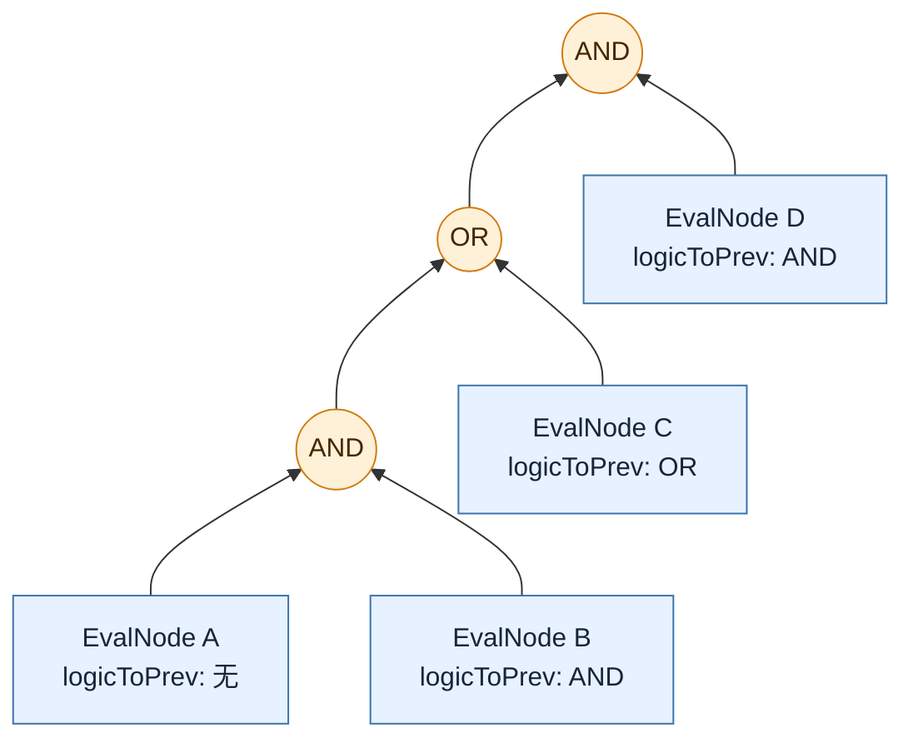
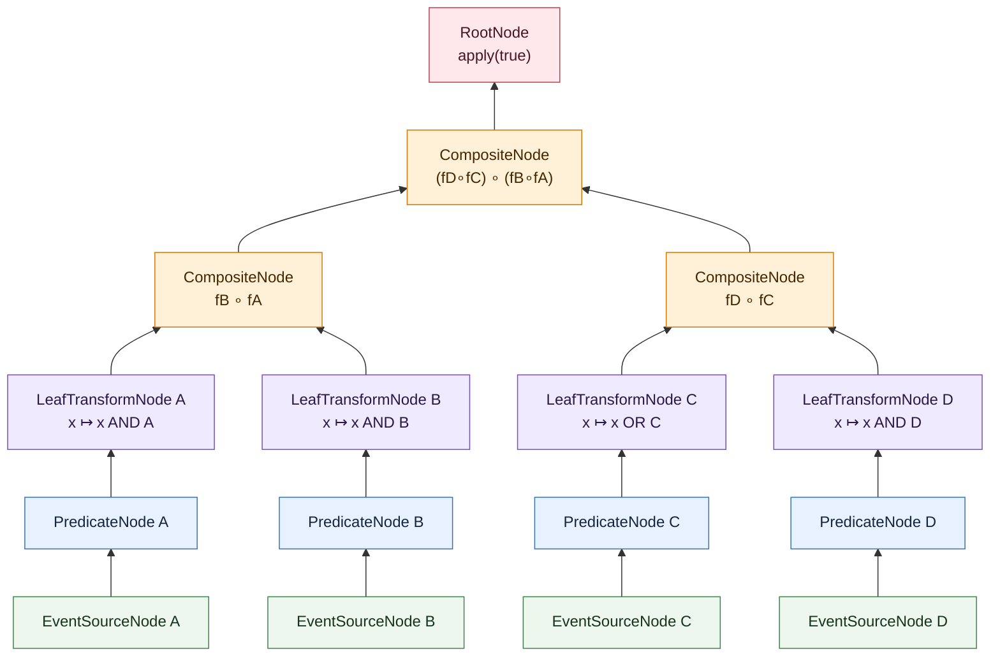

# EvalNode 左倾表达式树与 EvalForest 平衡变换树

本文用同一个表达式比较两种结构：

```text
((A AND B) OR C) AND D
```

输入链保存的是顺序信息：

```text
A --AND--> B --OR--> C --AND--> D
```

其中每个连接词实际保存在后一个 `EvalNode.logicToPrev` 中。首项 A 没有前项；进入 EvalForest 时会被统一归一为 `AND`。

## 1. 按 EvalNode 顺序左折叠得到的完全左倾树



等价的逐步求值过程是：

```text
r1 = A AND B
r2 = r1 OR C
r3 = r2 AND D
```

树高随条件数线性增长。4 个叶子时有 3 层运算节点；n 个叶子时运算路径最长为 `n - 1`。

## 2. EvalForest 当前构造的平衡 BooleanTransform 树

EvalForest 不直接构造上面的布尔运算 AST。它先把每个谓词结果转换成“如何修改前缀累计值”的一元函数：

```text
fA(x) = x AND A    // 首项被归一为 AND，从 true 开始
fB(x) = x AND B
fC(x) = x OR C
fD(x) = x AND D
```

然后通过 `BooleanTransform.then` 做函数复合。`left.then(right)` 表示 `right ∘ left`，因此叶子的先后顺序不会因平衡化而改变。



最终求值仍然是：

```text
Root.apply(true)
= fD(fC(fB(fA(true))))
= (((true AND A) AND B) OR C) AND D
= ((A AND B) OR C) AND D
```

注意：图中顶层标签的准确含义是先运行左子树，再运行右子树。Java 实现为 `leftValue.then(rightValue)`，也就是数学记法中的
`right ∘ left`。

## 3. 核心区别

| 维度   | EvalNode 原始左倾表达                   | EvalForest 当前结构                                         |
|------|-----------------------------------|---------------------------------------------------------|
| 输入表示 | `next` 串起谓词，`logicToPrev` 保存与前项关系 | 仍接收同一条 EvalNode 链作为编译输入                                 |
| 内部节点 | 概念上是 AND / OR 运算节点                | `CompositeNode`，只负责 `BooleanTransform` 函数复合             |
| 叶子   | 谓词布尔值 A/B/C/D                     | `LeafTransformNode`，值是完整一元布尔函数 `(onFalse, onTrue)`      |
| 树形   | 完全左倾                              | `buildBalanced` 递归二分得到平衡树                               |
| 结合依据 | 按链顺序左结合                           | 函数复合满足结合律，可以平衡化；叶子顺序不能交换                                |
| 结果入口 | 最上层 AND 节点的结果                     | `RootNode` 对最终 transform 执行 `apply(true)`               |
| 更新方式 | 直观上沿左倾累计路径重算                      | EventSource → Predicate → Leaf → Composite → Root 观察者传播 |
| 共享能力 | EvalNode 本身是一条表达式私有链              | 相同事件源与相同谓词可被森林中的多个表达式共享                                 |
| 高度   | O(n)                              | O(log n)                                                |

## 4. 为什么 AND/OR 混合时仍能平衡

普通布尔表达式不能把：

```text
((A AND B) OR C) AND D
```

随意改成：

```text
(A AND B) OR (C AND D)
```

二者不等价。EvalForest 也没有这样改写表达式。它平衡的是保持顺序的函数复合：

```text
(((fA then fB) then fC) then fD)
= (fA then fB) then (fC then fD)
```

因为 `then` 是函数复合，满足结合律；但它不满足交换律，所以 A、B、C、D 的相对顺序始终不变。这正是新结构既能保持左折叠语义，又能得到平衡树的原因。
