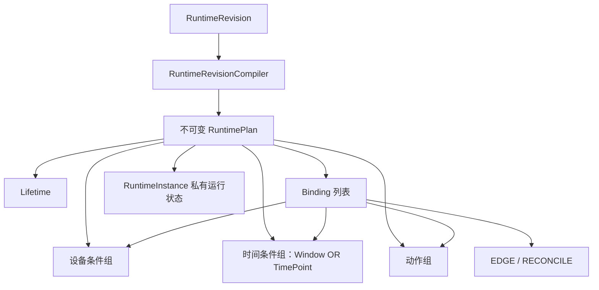
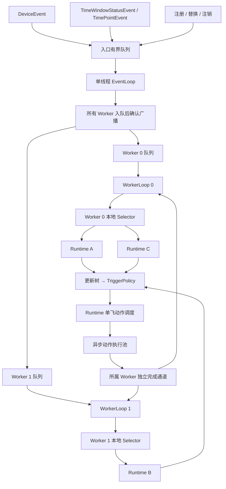
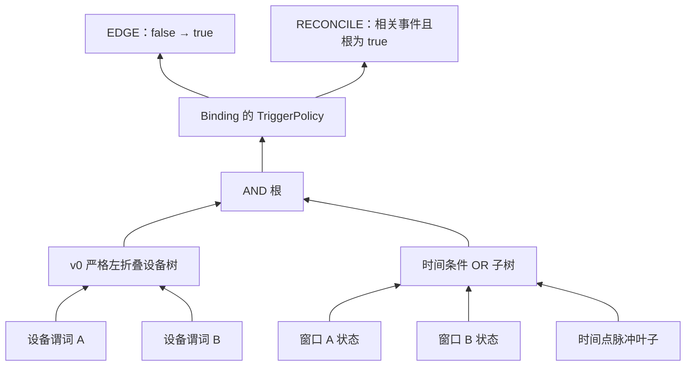

# Rule Engine v3

生产入口已切换到 v3。v2 核心、测试和演示在 `engine-v2-archive`，包前缀为 `xyz.jasenon.lab.archive.v2.engine`；生产模块不依赖归档模块，生产
Spring 扫描不覆盖归档包。

## 定义、计划、实例



保留现有业务 API、RuntimeRevision 和数据库格式。旧动作组编译为同名 Binding，按 ID 引用设备组、时间组及动作组。模式属于
Binding，不属于树或 Router。

Plan 集合及动作参数防御性复制；可变 MQTT DTO 在执行边界重新构造。Plan 不保存节点、窗口状态或线程句柄。相同 Runtime
内相同设备组/窗口组组合共享一棵完整树，不同 Runtime 不共享可变节点。

## 消费路径



Engine 只提供同步/异步 API 门面，委托 EngineEventLoop。入口循环维护事件顺序和管理屏障，将同一个不可变设备/窗口事件广播到所有 Worker，不查询 Runtime 订阅。

每个 WorkerLoop 拥有私有 RuntimeSelector：本地 registry 保存 RuntimeInstance，eventKey 订阅索引选择本地目标集合。窗口事件按 Runtime ID、generation、timerToken 在本地过滤。没有命中则直接完成，不扫描全部 Runtime。命中 Runtime 再用自己的 Binding/Tree 索引推进条件树。

注册、替换和注销按 runtimeId 固定分区到所属 Worker；Worker 同时修改实例及本地订阅索引。TimeScheduler 的内部 tick 已知 Runtime 身份，定向请求 Worker 校准窗口/生命周期，不向入口暴露 RuntimeInstance。

广播先将任务加入全部 Worker 队列，再完成 admission gate；gate 确认前各 Worker 不消费该事件，投递失败则已入队任务一起失败。确认仅保证完整投递，不提供跨 Runtime 的业务事务。accept 完成表示所有 Worker 消费结束。

Worker 只跟进有待执行请求的实例，动作完成通过独立通道唤醒，避免满入口队列死锁。

## 树和触发



叶子初始 false；空设备组或空时间组对应常量 true。不从 Redis 或内存恢复设备状态，不重放旧观测。

一次事件先记录 before，再更新所有命中叶子，最后读取 after 决策。传播遇到结果不变立即停止，但 affected 信息仍保留。相同值的新设备观测可以驱动
RECONCILE；重复窗口通知、旧窗口时间戳不驱动动作。调度器批量提交当前窗口状态，窗口交接不暴露中间根。

| 模式        | 触发                  | 执行期间的新请求                      |
|-----------|---------------------|-------------------------------|
| EDGE      | 完整根 false→true      | 保留每轮不可变决策，Runtime FIFO；不重新判断根 |
| RECONCILE | 相关观测或窗口有效变化且根为 true | 合并候选，可执行时重新判断最新根              |

Runtime 单飞跨 generation 保持。旧动作未结束时，新版本不会启动另一轮。每轮多个命中组可并发，编译器只保留显式配置的动作，
不会因 Control 自动追加 Poll。完成回调没有 pending 时不自动循环，新的设备观测仍是合法驱动。

## 时间和生命周期

时间条件组只支持 OR：完整根为设备条件 AND（Window OR TimePoint …）。TimePoint 定义沿用已有
日期、星期、时区和 timePoint 字段，支持创建、修改、启用及恢复，不需要迁移数据。只有时间点的组平时为 false。

定时器将同一计划时刻到达的时间点合并为不可变批次，携带 generation、timerToken、计划时间与条件标识。
Worker 在单个命令内记录旧根、更新当前窗口、将命中脉冲叶子置 true、应用根触发策略并尝试提交执行，
最后在 finally 中复位；复位不判断触发策略，不等待外部动作，不创建复位定时任务，快照始终在复位后发布。

- EDGE 仅完整根 false→true 时保留 FIFO 决策；有效窗口已使根为 true 时，时间点不额外触发。
- RECONCILE 空闲时在复位前尝试提交。忙碌或执行池拒绝时保留合并候选，之后重查最新根；
  若只靠脉冲成立，复位后候选失效。动作完成不会自动生成新脉冲。
- 每个时间点只保留本 generation 最近一次计划时间，用于拒绝重复或更旧的到达，空间随条件数有界。
- 注册/恢复不补发历史时间点。已安排批次延迟消费时仍处理该批次，但检查消费时的窗口和生命周期；
  后续调度从当前时钟继续，不补造错过的批次。投递拒绝时重试同一个不可变批次。
- 同刻窗口边界与脉冲合并处理，避免窗口交接产生中间根；旧 generation/token 的回调无效。

- 生命周期 `[activeFrom, activeUntil)`；Pending 更新设备状态但不执行动作。
- 激活先初始化窗口，再检查当前条件一次；设备未知谓词仍为 false。
- TimeScheduler 发送定时意图，Worker 按消费时间计算并应用窗口状态，不重演历史边界。
- 窗口 `[start,end)`，跨午夜按开始日匹配日期/星期，起止相同非法。日期两端包含，时区沿用既有 ZonedDateTime 行为。
- 消费命令及开始动作前检查有效期，不只依赖到期回调。

## 安装、注销和背压

编译、候选构建和定时准备失败时保留旧版本。EventLoop 到达安装屏障后暂停消费后续事实，等待 Worker
处理先前命令、初始化候选并在 Worker 内切换实例和本地订阅索引，再取消旧定时器，最后确认成功。注销采用相同入口屏障。generation/token 隔离旧回调。

取消栅栏阻止未开始的旧动作；已开始的外部操作不能撤回。数据库沿用事务提交后同步内存引擎，不提供跨数据库/设备的分布式事务。

入口满时明确拒绝外部调用，Worker 或待执行区满时背压。内部定时投递失败保留意图重试，完成消息走独立通道。待执行容量按执行轮次计数，一轮可含多个
Binding。若外部动作永不完成，单飞和背压会保留积压，须由传输层超时解决；不新增自动动作重试。

第一版固定分区：热点 Runtime 饱和可能使同 Worker 的其他 Runtime 等待；任一 Worker 队列饱和也会背压后续广播。不实现迁移或独立 Actor mailbox 公平调度。

## 包、接口与配置

选择逻辑位于 scheduling.RuntimeSelector，由 WorkerLoop 独占；EngineEventLoop 只广播及管理拓扑/定时元数据。

核心包为 `plan/compiler/event/routing/runtime/eval/trigger/scheduling/execution`。通知契约在 `execution.notice`
；持久化、业务服务、设备输入、授权及实时通知适配在 `infrastructure`。

Engine 提供同步及异步 register/remove/accept；同步接口只用于外部调用线程。`runtime` 返回最近发布的不可变快照，`inspect` 是经过
Worker 的屏障查询，`queueDepths` 返回入口和 Worker 积压。

```yaml
lab:
  rule-engine:
    v3:
      workers: 4 # 默认 max(1, CPU - 1)
      ingress-capacity: 8192
      worker-capacity: 8192
      pending-capacity: 1024
      execution-threads: 4 # 默认 max(2, CPU / 2)
```

## 验证

```sh
zsh -lic 'cd lab-system-cloud && whence -a java && java -version && ./mvnw -o -pl domains/rule/benchmark -am clean verify'
zsh -lic 'cd lab-system-frontend && npm run typecheck && npm run lint && npm test -- src/modules/strategy && npm run build'
```

覆盖推理、执行协调、原子替换、旧事件、过载、传输适配、数据库恢复、归档和历史语义对照。性能入口和测量边界见
`../../benchmark/README.md`。
